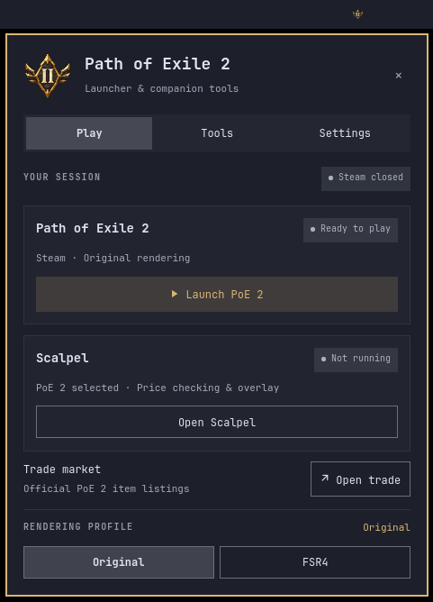
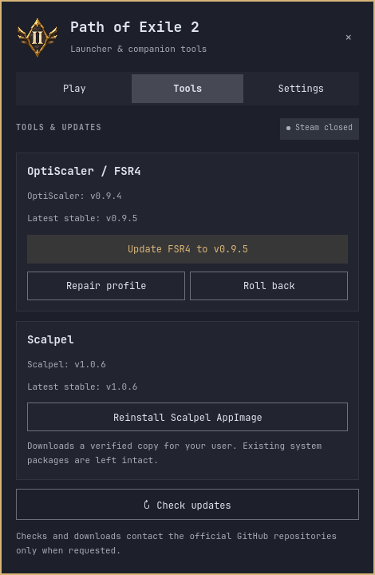
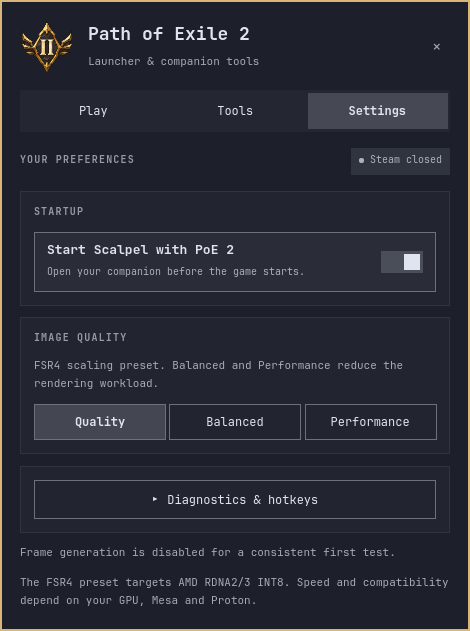
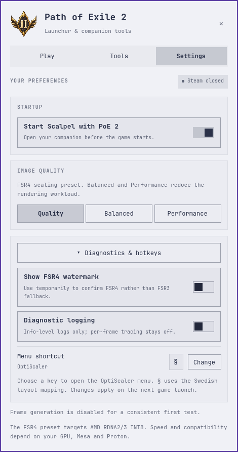
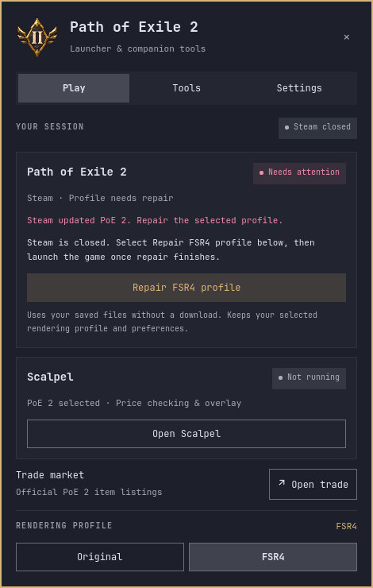

# Omarchy PoE 2


## Install

```bash
omarchy plugin add https://github.com/usergood/omarchy-poe2 --enable
```

Choose **right** for bar placement, then click the **gold II emblem** to open
Play. The widget runs on Omarchy Quattro with its Quickshell bar on Hyprland.
For game launch, use native Steam on x86-64 with PoE 2 installed, and launch
the game once from Steam. The widget needs Python 3.10+. Trade links use
`xdg-open` from `xdg-utils`.



<details>
<summary>See Tools and Settings in dark and light themes</summary>

**Tools** shows installed versions, checks for updates and offers profile repair.



**Settings** puts startup and image quality first. Expand **Diagnostics & hotkeys**
to change the watermark, logging or the menu shortcut.





</details>

## Start playing

Open **Play** and choose **Launch PoE 2**. The cards show whether PoE 2 and Scalpel
are running, and the Steam badge shows whether Steam is open.

**Open trade** opens the official PoE 2 trade site in your browser.

### Add Scalpel for price checks

Scalpel is optional. Its AppImage typically needs `fuse2`, and the overlay uses XWayland.

1. If Scalpel is missing, choose **Set up Scalpel** in Play to go directly to **Install Scalpel AppImage** in Tools. You can also use an existing system installation.
2. Return to **Play** and choose **Open Scalpel setup**.
3. Complete Scalpel's setup and select **PoE 2**. Let it restart if it asks.
4. Return to the plugin and launch the game.

By default, the plugin starts Scalpel with PoE 2. If Scalpel still needs setup,
it opens Scalpel first and waits for you to finish. Click **Launch PoE 2** again
when you are ready. You can turn automatic startup off under **Settings**.

### Try FSR4 upscaling

This optional OptiScaler preset targets AMD RDNA2/3 GPUs. Extraction uses `bsdtar`
from `libarchive`. See the [GPU, Vulkan and driver requirements](docs/technical-reference.md#compatibility-and-dependencies).

1. In Steam, open PoE 2's **Properties → Compatibility** and select a recent GE-Proton or Proton Experimental.
2. Close PoE 2 and fully exit Steam.
3. Open **Tools → Install FSR4**, review the changes, and choose **Apply FSR4**.
4. Return to **Play** and launch PoE 2.

Use **Original** or **FSR4** under **Rendering profile** to switch between them.
Close the game and Steam before switching. **Original** restores the game setup
saved before FSR4 was installed.

Under **Settings**, try **Quality**, **Balanced** or **Performance** to find what
works best on your PC. FSR4 is not guaranteed to improve performance.

## After a game update

If the game card says **Profile needs repair**, follow the steps shown there:

1. Close PoE 2 if it is running.
2. Click **Exit Steam to repair** and wait for the **Steam closed** badge.
3. Click **Repair Original profile** or **Repair FSR4 profile**, depending on your selection.
4. When repair finishes, click **Launch PoE 2**.



Repair uses saved files without downloading them again. It keeps your selected
profile and preferences. It does not switch you from Original to FSR4.

## Make it yours

Open **Settings** to change automatic Scalpel startup, FSR4 image quality, the
verification watermark, or diagnostic logging.

To change the OptiScaler menu shortcut:

1. Close PoE 2 and Steam.
2. Expand **Diagnostics & hotkeys** and click **Change** beside **Menu shortcut**.
3. Press a key, then choose **Accept key**. Use **Try another** or **Cancel** if needed.

The default is **§ on a Swedish keyboard**. Single keys such as F10 are supported;
Esc cancels recording. The new shortcut applies the next time you launch the game.

## Updates and common questions

- **Update the plugin:** use Omarchy's plugin manager.
- **Update Scalpel or FSR4:** choose **Check updates** under **Tools** to see available versions. Use the action on the corresponding tool card.
- **Old icon or layout after updating?** Run `omarchy restart shell` once.
- **Game not found?** Check that PoE 2 is installed in regular Steam, then launch it once from Steam.
- **Buttons are dimmed?** Fully exit PoE 2 and Steam before changing graphics settings, shortcuts or profiles.
- **Scalpel is open but price checking does not work?** Finish its setup, check that PoE 2 is selected, and review its hotkeys. See [troubleshooting](docs/technical-reference.md#troubleshooting-and-safety) for more help.

## Remove the plugin

If you used only the launcher, trade or Scalpel, go straight to the removal command below.

If you used FSR4, close PoE 2 and fully exit Steam. In **Play**, select
**Original** and wait for the restoration to succeed before removing the widget.
If the panel asks for repair, follow its instructions and then select
**Original** again.

```bash
omarchy plugin remove usergood.poe2
```

Confirm removal when prompted. Omarchy removes the widget. The plugin's saved
preferences, recovery backups and any managed Scalpel AppImage remain in
`~/.local/share/omarchy/poe2-addon/`. Keep the backups until you have verified
that the game launches with the restored settings.

For advanced settings, development installation, compatibility and developer checks,
see the [technical reference](docs/technical-reference.md).

This is an independent community plugin. PoE 2, [Scalpel](https://github.com/scalpelpoe/scalpel)
and [OptiScaler](https://github.com/optiscaler/OptiScaler) are separate projects.
FSR4 uses a third-party game modification; review the upstream compatibility and usage notes before enabling it.

## License

The plugin is available under the [MIT License](LICENSE). Scalpel and OptiScaler
are optional external downloads governed by their own licenses.
